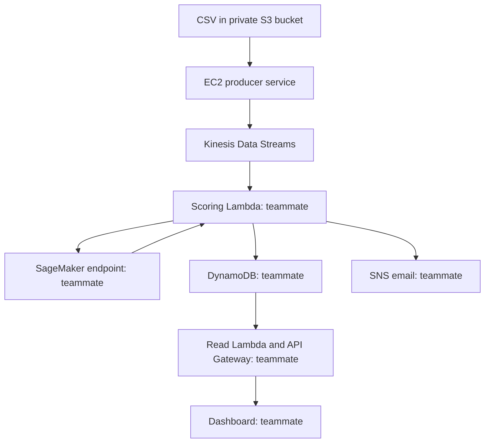

# Credit Card Fraud Detector

## Current status and the AWS permission blocker

As of October 16, 2026:

| Component | Status |
|---|---|
| Python 3.11 local setup | Working on Nikhila's Mac |
| Automated producer tests | 9/9 passed on Nikhila's Mac |
| Full source test-file conversion | All 555,719 rows passed in the authoring environment |
| AWS CLI authentication | Successful in Nikhila's account |
| CloudFormation deployment | Blocked before any resources were created |
| Live EC2 producer and Kinesis writes/reads | Not yet deployed or verified |
| Downstream scoring/storage/alerts/API/dashboard | Separate teammate work |

The attempted deployment was denied at `cloudformation:ValidateTemplate` by an
AWS Organizations Service Control Policy (SCP). A separate read-only
`ec2:DescribeVpcs` request in `us-east-1` was denied by the same SCP (`p-g4nbuldf`).
This is an account/organization restriction, not a Python or producer-code failure.
The exact scope of the SCP and whether the region contributes to the deny are unknown.
An IAM role named FullAccess does not override an organization explicit deny.
Removing the validation check or using the console does not grant the denied permission.

**When clonning the repo and running on local system** Use your own AWS identity and verify the returned account before deployment. Your account must independently permit all required services.
If it returns an explicit SCP deny too, contact its administrator for the approved
account/region/permissions. Do not assume a different account guarantees access.

## quick start

The commands below are for a Mac/Linux terminal. Replace `REPOSITORY_URL` with the
GitHub URL. Use one terminal so the environment/profile remain selected.
Run each block in order. These commands deploy billable resources in YOUR account.

### A. Clone and install

```bash
git clone REPOSITORY_URL
cd credit-card-fraud-detector
```

On a Mac with Homebrew:

```bash
brew install python@3.11 awscli git
"$(brew --prefix python@3.11)/bin/python3.11" -m venv .venv311
source .venv311/bin/activate
python --version
python -m pip install -r requirements.txt
aws --version
```

The project Python should report 3.11.x. The Python version inside `aws --version`
may differ; the CLI uses its own environment. On Linux use an installed Python 3.11:
`python3.11 -m venv .venv311`, then the same activate/install commands.
On Windows use `py -3.11 -m venv .venv311` and PowerShell
`.\.venv311\Scripts\Activate.ps1`, with AWS CLI v2 installed separately.

The requirements include Boto3's CRT extra because local verification through Python
must support browser-based `aws login` sessions as well as the AWS CLI. This is not
needed to pass the offline tests, but is needed for that credential method in Boto3.

### B. Add the dataset locally

```bash
mkdir -p data
```

Get `fraudTest.csv` from Nikhila through the team's approved file-sharing method, or
from the team's original licensed data source. Copy it to `data/fraudTest.csv`.
The full datasets are NOT included in this Git repository. The producer needs only
the test file; the training teammate separately needs `fraudTrain.csv`.

```bash
ls -lh data/fraudTest.csv
python -m unittest discover -s tests -v
python src/producer.py --csv data/fraudTest.csv --dry-run --max-records 3 --rate 100
```

Expected: nine tests end in `OK`, and the dry run prints three JSON events.
The test's deliberate `TimeoutError: network` log is expected if the final result is OK.
No AWS resources are created by these local checks.

### C. Authenticate to YOUR AWS account

Choose ONE authentication method supported by your account.

Browser/console login with a recent AWS CLI v2:

```bash
aws configure set region us-east-1 --profile fraud-team
aws login --profile fraud-team
export AWS_PROFILE=fraud-team
export AWS_DEFAULT_REGION=us-east-1
aws sts get-caller-identity
```

Follow the browser flow and verify the identity belongs to YOUR intended account.
If your organization instead uses IAM Identity Center, replace the first two commands
with `aws configure sso --profile fraud-team` and
`aws sso login --profile fraud-team`, then export the same profile and region.
If using an approved course lab, use its supplied temporary CLI credentials and session
token instead. Do not commit credentials or share them with teammates.

`us-east-1` is the example project region. If your account permits a different region,
set AWS_DEFAULT_REGION to that approved region and use it throughout. On Windows
PowerShell set `$env:AWS_PROFILE="fraud-team"` and
`$env:AWS_DEFAULT_REGION="us-east-1"` instead of the export commands.

### D. Check permissions before creating resources

```bash
aws ec2 describe-vpcs --region "$AWS_DEFAULT_REGION" --query 'Vpcs[].{VpcId:VpcId,Default:IsDefault}' --output table
aws cloudformation validate-template --region "$AWS_DEFAULT_REGION" --template-body file://infra/template.json
```

If either returns an explicit deny, stop and check account/region policy with the
administrator. If they succeed, that is only a preliminary check: actual creation still
requires EC2/VPC, Kinesis, S3, CloudFormation, SSM AMI-parameter and IAM/pass-role rights.
You do not need an existing default VPC; this template creates its own VPC/subnet.

### E. Deploy

```bash
python scripts/manage.py deploy --data data/fraudTest.csv --stack fraud-ingestion --region "$AWS_DEFAULT_REGION" --rate 5
```

This validates the template, deploys infrastructure, uploads the dataset/code to S3,
and allows EC2's background service to begin replay. Leave the terminal open until
this command completes. It prints StreamName, StreamArn, DataBucketName, InstanceId,
and Region and saves them to `.local/outputs.json` (excluded from Git).

CloudFormation completion does not mean EC2 package installation has finished.
Allow several more minutes, then verify rather than assuming success.

### F. Verify live ingestion

```bash
python scripts/manage.py status --stack fraud-ingestion --region "$AWS_DEFAULT_REGION"
python scripts/manage.py logs --stack fraud-ingestion --region "$AWS_DEFAULT_REGION"
python scripts/verify_stream.py --stack fraud-ingestion --region "$AWS_DEFAULT_REGION" --count 10
```

Expected: service is active, logs show increasing published counts, verifier reads
ten NEW events. If SSM has not registered yet, wait and check again. If the verifier
fails, inspect logs; do not mark cloud integration complete yet.

The verifier also writes `.local/live-lambda-fixture.json` for backend testing. Open
Kinesis -> Data streams -> printed StreamName -> Monitoring to inspect IncomingRecords.

### G. Share the successful handoff

Share the repository commit, region, stream name/ARN, dataset mode and evidence of new
records. Read `docs/HANDOFF.md` before connecting the model or Lambda. Use individual,
authorized AWS identities: sharing the repository does not share AWS access.

### H. Stop or remove resources

Pause only the producer service:

```bash
python scripts/manage.py stop --stack fraud-ingestion --region "$AWS_DEFAULT_REGION"
```

EC2 and Kinesis are STILL billable after that service stops. When the team is finished,
confirm consumers no longer need the stream, then delete the ingestion stack and its
staged S3 files:

```bash
python scripts/manage.py destroy --stack fraud-ingestion --region "$AWS_DEFAULT_REGION" --yes
```

Delete downstream teammate resources, especially SageMaker endpoints, separately.

---

## Detailed reference

The sections below explain the architecture, data, permissions, controls and integration.

## Architecture



The final system detects simulated suspicious transactions. A historical replay does
not stop a real card authorization before settlement. Do not claim that capability.

## Before starting

1. Use an active AWS account or the course's approved lab account. If the account is
   suspended, resolve that first. Choose one account/region with the team.
2. The deployer needs CloudFormation, EC2/VPC, Kinesis, S3, SSM Parameter Store AMI reads,
   and IAM create/pass-role permissions. Management commands additionally need SSM
   SendCommand/GetCommandInvocation. Stream verification needs Kinesis read permissions.
3. If the lab prohibits IAM role creation, ask for an existing EC2 INSTANCE PROFILE
   name and use --instance-profile NAME. That profile must already allow SSM,
   kinesis:PutRecords to the created stream, and s3:GetObject for this stack's
   data/artifacts. Merely naming LabRole does not grant missing permissions.
4. This makes billable resources: EC2, EBS, public IPv4, Kinesis and S3. Check regional
   pricing, set a budget alert, and destroy after the demo. Teammates' SageMaker
   endpoint can continue billing independently of this stack.

## 1. Put the repository on your Mac

Unzip fraud-stream-starter.zip, open Terminal, and change into that folder:

```bash
cd ~/Downloads/fraud-stream-starter
python3 --version
aws --version
```

Use Python 3.11 or newer. If you use Homebrew and a tool is missing:

```bash
brew install python@3.11 awscli git
```

Create an environment using the appropriate Python executable on your Mac:

```bash
python3.11 -m venv .venv311
source .venv311/bin/activate
python -m pip install -r requirements.txt
python -m unittest discover -s tests -v
```

requirements.txt declares the Boto3 compatibility range with its CRT extra. To reproduce the exact local
SDK resolved on your machine, save `python -m pip freeze > requirements.lock.txt` after
setup and commit that lock file; use `-r requirements.lock.txt` on matching Python
versions. No dependencies are installed from your credentials or notebook.

## 2. Authenticate the AWS CLI

Use the login method your account administrator provides. For an IAM Identity Center
account, for example:

```bash
aws configure sso --profile fraud-team
aws sso login --profile fraud-team
export AWS_PROFILE=fraud-team
export AWS_DEFAULT_REGION=us-east-1
aws sts get-caller-identity
```

For a classroom lab, use its supplied temporary AWS CLI credentials, INCLUDING the
session token, and refresh them when they expire. An IAM user account may instead use
`aws configure`. Do not publish credentials, access keys, session tokens or .aws files.
Inspect get-caller-identity before deploying: it must be the intended account.

## 3. Keep the supplied datasets outside Git

Create data/ and copy the two original files there using Finder:

```bash
mkdir -p data
```

Expected local paths:

- data/fraudTrain.csv: model training teammate's input, not required by EC2.
- data/fraudTest.csv: default streaming input.

The inspected files contain 1,296,675 and 555,719 rows respectively. Details are in
`docs/dataset_profile.json`. Their sizes are about 351 MB and 150 MB in decimal units.
Do not commit them. `data/` and all CSVs except the invented example are ignored.
GitHub blocks regular Git files above 100 MiB. Share original data through approved
S3 access or its licensed source instead of putting it in Git history.

## 4. Test offline, without creating any AWS resource

The committed CSV has 20 entirely invented transactions and 10% demo labels. It is
only for code checks, not ML training or evaluation.

```bash
python src/producer.py --csv examples/synthetic_sample.csv --dataset synthetic_sample --dry-run --max-records 3 --rate 100
```

You should see JSON with schema_version, event_id, features and ground_truth.
The label must NOT appear inside features. Test your actual file too:

```bash
python src/producer.py --csv data/fraudTest.csv --dry-run --max-records 3 --rate 100
```

Raw names, addresses, date of birth and card numbers are not published. account_id
is a deterministic demo pseudonym, not a production payment token.

## 5. Deploy your AWS ingestion stack

This command creates a new VPC/public subnet, an internet route, an outbound-only
security group, an Amazon Linux 2023 EC2 instance, an instance profile (unless supplied),
a private S3 staging bucket and a one-shard provisioned Kinesis Data Stream.
It then uploads the dataset and producer code. You do not manually create Kinesis first.

```bash
python scripts/manage.py deploy --data data/fraudTest.csv --stack fraud-ingestion --region us-east-1 --rate 5
```

An existing lab profile can be supplied, if authorized:

```bash
python scripts/manage.py deploy --data data/fraudTest.csv --stack fraud-ingestion --region us-east-1 --rate 5 --instance-profile YOUR_APPROVED_INSTANCE_PROFILE
```

Deployment prints StreamName, StreamArn, DataBucketName, InstanceId and Region,
and stores them locally in .local/outputs.json. Creation can take several minutes.
EC2 setup continues after CloudFormation reports success. The service retries if
code/data has not finished uploading; allow several more minutes for installation.

The instance has public outbound internet for package downloads/AWS endpoints, but
no inbound rules or SSH key pair. Use Session Manager, not SSH. A stopped/disconnected
terminal does not stop the systemd service.

## 6. Verify EC2, service and new Kinesis records

```bash
python scripts/manage.py outputs --stack fraud-ingestion --region us-east-1
python scripts/manage.py status --stack fraud-ingestion --region us-east-1
python scripts/manage.py logs --stack fraud-ingestion --region us-east-1
python scripts/verify_stream.py --stack fraud-ingestion --region us-east-1 --count 10
```

If SSM says the instance is not connected, wait for boot and check EC2 -> instance ->
Connect -> Session Manager. The SSM agent, instance profile and outbound internet must
all work. CLI management uses Run Command and does not require the Session Manager
plugin on your Mac. An interactive CLI session would require that plugin.

The verifier starts at LATEST, waits for NEW records, validates the basic event
contract and saves .local/live-lambda-fixture.json. It does not delete records or
steal Lambda's cursor. Don't run a second local producer while EC2 is already running
unless additional transactions are intentional.

In the console, choose the same region:
- EC2 -> instance: Running and status checks passing.
- Kinesis -> Data streams -> printed StreamName -> Monitoring.
- Inspect IncomingRecords/IncomingBytes and write errors/throttling. Metrics can lag.
- Session Manager: `sudo journalctl -u fraud-producer -n 40 --no-pager`.
- Bootstrap errors: `sudo tail -n 80 /var/log/cloud-init-output.log`.

Expected rate is approximately 5 records/sec, batched in groups of 5. Network/setup
latency makes actual throughput lower; this is not a 5/sec performance guarantee.

## 7. Start, stop, change rate and update code

```bash
python scripts/manage.py stop --stack fraud-ingestion --region us-east-1
python scripts/manage.py start --stack fraud-ingestion --region us-east-1
python scripts/manage.py restart --stack fraud-ingestion --region us-east-1
```

`stop` here stops ONLY the producer service. EC2, storage and Kinesis remain billable.
To change rate on an existing instance, use EC2 Connect -> Session Manager:

```bash
sudo sed -i 's/^RATE=.*/RATE=10/' /opt/fraud/config.env
sudo systemctl restart fraud-producer
```

Source code update: rerun the deploy command with unchanged infrastructure parameters,
then run restart. It downloads the new code artifact and resumes its checkpoint.
Do not assume updating CloudFormation UserData reruns boot setup: it normally does
not. For rate changes use the command above; for changes to bootstrap/schema/dataset,
create a fresh stack or deliberately rebuild/reset with the team. Existing local
transactions.csv is cached, so uploading a new CSV alone does not replace it.

The checkpoint is /opt/fraud/state/checkpoint.json. Restart resumes the same file.
At EOF, loop mode increments replay_cycle and starts again. Changing the dataset
requires an intentional fresh replay/checkpoint, not silently reusing an old offset.

## 8. Optional presentation data: more fraud examples

The original test set has only 0.386% known fraud. For a short demo, create a separate,
clearly named 200-row sample with 20 known-fraud rows and 180 non-fraud rows:

```bash
python scripts/prepare_demo.py data/fraudTest.csv
python scripts/manage.py deploy --data .local/fraudDemo.csv --dataset-name fraudTest-demo --stack fraud-demo --region us-east-1 --rate 5
```

This is a SEPARATE stack and therefore adds cost. Stop/destroy the first when appropriate.
The enriched data changes prevalence and temporal order. Never report its precision,
recall or accuracy as representative holdout performance. Known fraud does not mean
the teammate's model will predict fraud or send an alert.

## 9. Give teammates the handoff

Read docs/HANDOFF.md together before model/API implementation. Share:
- GitHub repository URL and commit.
- Account/region (no credentials), StreamName, StreamArn.
- examples/event.json, examples/lambda_event.json and feature contract v1.
- Whether full test data or enriched demo is running, and the current rate.
- Who owns the stack and when it may be deleted.

The recommended path is one shared AWS stack, not every teammate launching a producer.
A teammate clones, installs dependencies, authenticates their own identity and runs:

```bash
python scripts/verify_stream.py --stream THE_SHARED_STREAM_NAME --region us-east-1 --count 10
```

They need permission to ListShards/GetShardIterator/GetRecords on the shared stream.
AWS credentials, permissions, the external dataset and teammate services are real
prerequisites; Git clone alone does not create a complete functioning fraud detector.

## 10. Put the code on GitHub

Create an empty private repository in GitHub (example: credit-card-fraud-detector).
Do not initialize it with another README if using this existing directory.

```bash
git init
git add .
git status --short
```

Check the list: no original fraudTrain/fraudTest CSVs, no .local, no .venv/.venv311 and no keys.
Then:

```bash
git commit -m "Add reproducible EC2 transaction replay and Kinesis ingestion"
git branch -M main
git remote add origin https://github.com/YOUR_USERNAME/credit-card-fraud-detector.git
git push -u origin main
```

Authenticate Git with GitHub's supported method, not your AWS credentials.
Invite collaborators using repository Settings -> Collaborators.
A teammate runs `git clone REPOSITORY_URL`, enters the folder and follows this README.
A GitHub Actions workflow runs the offline checks on pushes/pull requests.

## 11. What is done so far

- Unit-test output and offline replay example.
- CloudFormation stack outputs; status checks passing.
- Producer log showing published record counts.
- Verifier showing 10 NEW valid stream records.
- Kinesis IncomingRecords graph with approximate expected rate.
- Teammate confirms they can decode the fixture and read the shared stream.
- Documented versioned feature contract and label separation.

This completes ingestion, not inference/model accuracy, persistence, alert delivery,
API authorization or dashboard acceptance tests.

## 12. Clean up when the team is finished

First stop dependent consumers and agree with the team; this deletes source events.
Destroy THIS ingestion stack including its staged dataset and code bucket:

```bash
python scripts/manage.py destroy --stack fraud-ingestion --region us-east-1 --yes
```

If deployed, destroy fraud-demo separately too. Stopping EC2 alone does not delete
Kinesis/EBS/S3. Teammates must delete SageMaker endpoints and their other infrastructure
separately. If deletion fails, read CloudFormation events; do not assume billing stopped.


## Validation and dependencies

Offline validation is recorded in docs/VALIDATION.md. AWS deployment was not performed
in the authoring environment. Run AWS template validation/deployment and the live smoke
test in your own authorized account before claiming the system works on AWS.

